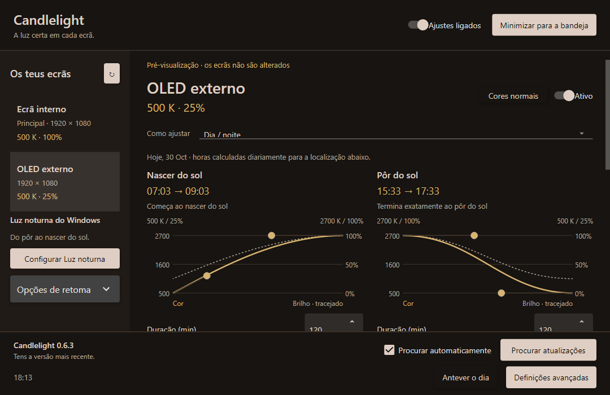

# Candlelight

<p></p>

Uma versão para Windows baseada no [LightBulb](https://github.com/Tyrrrz/LightBulb),
com temperatura de cor, brilho e transições solares independentes para cada monitor.

**[⬇ Descarregar o instalador Windows](https://github.com/DacostaWeb/Candlelight/releases/latest/download/Candlelight-Setup-win-x64.exe)**

[Versão portátil ZIP](https://github.com/DacostaWeb/Candlelight/releases/latest/download/Candlelight-win-x64.zip)
· [Guia de instalação](docs/install.pt-PT.md)
· [Todas as versões](https://github.com/DacostaWeb/Candlelight/releases)

**Versão 0.6.1:** mantém a Luz noturna sob controlo do Windows e traz os ajustes
experimentais de despertar desligados por defeito. As curvas solares e os
controlos separados por monitor continuam disponíveis.



## Instalar em qualquer PC compatível

1. Descarrega e executa **Candlelight-Setup-win-x64.exe**.
2. Mantém **Iniciar com o Windows** e, no fim, **Configurar a Luz noturna do Windows** selecionados.
3. Nas Definições do Windows, ativa **Agendar luz noturna → Do pôr ao nascer do sol** e escolhe a intensidade.
4. No Candlelight, escolhe a tua cidade e ajusta cada ecrã. Para o OLED, podes usar **500 K / 25%** à noite; no interno, **500 K / 100%**.

Suporta **Windows 10 (19041+) e Windows 11, x64**. Inclui o .NET e pode ser
instalado offline depois do download. Não precisa de serviços ou certificados
adicionais. O instalador não altera permissões de localização automaticamente.

Se o Windows mostrar **00:00–00:00**, vê o [guia de localização e tweaks de
privacidade](docs/install.pt-PT.md#luz-noturna-e-privacidade). O Candlelight tem
um botão **Configurar Luz noturna** para voltar a essa página a qualquer momento.

Installation is per-user in `%LOCALAPPDATA%\Programs\Candlelight`. Settings are
stored in `%APPDATA%\Candlelight\Settings.json`. Installing over a portable copy
imports its settings if no installed settings already exist. Reinstalling keeps
the settings. Uninstall through **Windows Settings > Apps > Candlelight**;
uninstall removes the application and its shortcuts, and retains your settings.

The installer is not code-signed. Windows may display an unknown-publisher or
SmartScreen warning. The release includes SHA256 checksums; no certificates or
background services need to be installed. The application may separately offer
to unlock Windows' gamma range, which requires administrator approval.

A portable ZIP is also available: extract it and run `Candlelight.exe`.
Portable settings stay beside the executable. Close other gamma tools first.

## Controls

- Select a monitor in the left rail. Temperature and brightness apply to that
  monitor alone, including 500 K red-only output and software brightness down to 1%.
- Choose **Dia / noite**, **Manual**, or **Horários** independently per screen.
- In **Dia / noite**, set your city or coordinates once under **Localização do
  sol**. Sunrise and sunset update every day, including daylight saving
  changes, using the Windows time zone. New profiles default to 500 K at night
  and 2700 K during the day, with two-hour transitions.
- The morning transition **starts at sunrise**; the evening transition **ends at
  sunset**. Drag the two handles on each curve, choose a curve preset or edit its
  duration. Set night brightness to 25% for an OLED and 100% for an internal display
  to keep separate brightness levels while both reach 2700 K / 100% by day.
- **Cores normais** temporarily bypasses only the selected monitor's adjustments.
  **Retomar ajustes** returns to its saved program at the current time. This
  choice persists across restarts until switched off.
- **OLED vermelho** applies 500 K and 15% brightness to the selected monitor.
- Save your own presets, or use the built-in day, reading, night and red presets.
- Daily schedules support `HH:mm`, temperature, brightness and transition duration,
  including transitions across midnight. Changes save automatically.
- Physical monitor identity can retain profiles between HDMI and USB-C if the
  monitor reports the same serial on both connections.

This version targets SDR monitors on an extended desktop. Windows Night Light
with a sunset-to-sunrise schedule is the recommended wake configuration. The user
confirmed that the initial wake flash became warm/yellow on the tested PC.
Experimental wake recovery and **Pausa a preto** are off by default, including on
the first upgrade from older versions. They remain under **Opções de retoma**.
Hardware results vary; see [the hardware findings](docs/wake-recovery.md).

## Build and verify

Requires .NET SDK 10 on Windows. Installer builds also require Inno Setup 6.3+.

```powershell
dotnet build LightBulb.slnx --configuration Release
dotnet test LightBulb.Core.Tests --configuration Release --no-build
dotnet LightBulb/bin/Release/net10.0-windows/Candlelight.dll --preview --capture-preview=artifacts/ui
./scripts/publish.ps1
./scripts/build-installer.ps1
./scripts/verify-installer.ps1 -InstallerPath artifacts/release/Candlelight-0.6.1-Setup-win-x64.exe
```

Installer verification runs on a machine without an installed/running Candlelight.
It checks installation, the included runtime, real compiled UI controls, repeat
installation, uninstall, settings preservation and startup isolation. Preview
mode uses synthetic displays and does not change screen colors or autostart.
CI publishes both an installer and a portable ZIP, without personal settings.
Pushing a version tag publishes the downloads and SHA256 checksums only after
all verification steps pass. Release notes live in `docs/releases/<version>.md`.

`--list-displays` and `--diagnose-displays=report.txt` inspect monitors read-only.
`CANDLELIGHT_SETTINGS_PATH` can override the settings location. Automatic upstream
updates are disabled for this fork.

## Credits

Based on LightBulb by Oleksii Holub, with exact-zero red-channel handling adapted
from [LightBulb Ahead](https://github.com/karipesonen/LightBulb-Ahead).
See [third-party credits](THIRD_PARTY.md) and the preserved [MIT license](License.txt).
