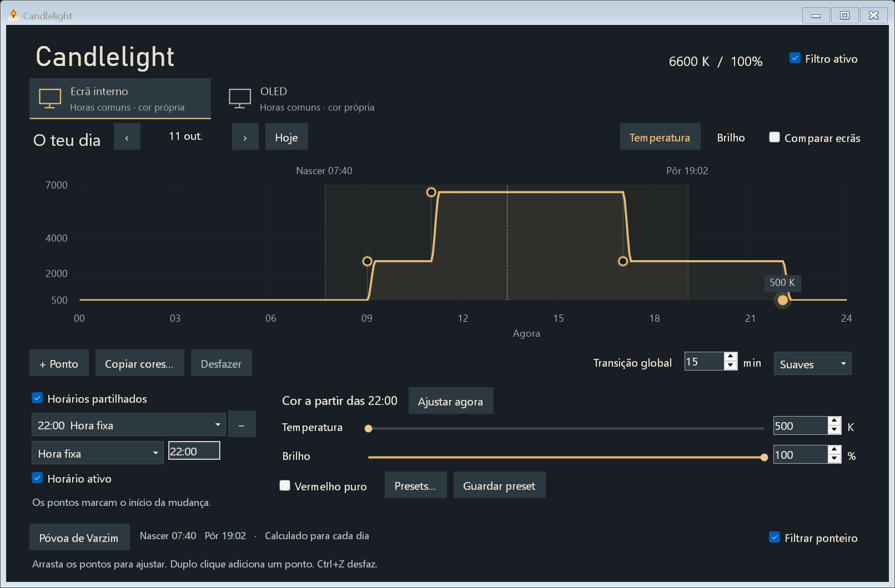

# Horários no Candlelight 0.3

Escolhe o monitor no topo. As horas são partilhadas por defeito; a temperatura,
o brilho e o vermelho puro pertencem apenas ao monitor selecionado.

- Arrasta um ponto na horizontal para mudar a hora e na vertical para ajustar
  a temperatura ou o brilho. Usa os separadores do gráfico para escolher o valor.
  As mudanças são guardadas ao largar; Escape cancela o arrasto.
- Um duplo clique no gráfico, ou **+ Ponto**, acrescenta uma mudança. **−** ou
  Delete remove o ponto selecionado. **Desfazer** e Ctrl+Z recuperam a última alteração.
- Seleciona um ponto para editar os valores exatos abaixo. As setas no gráfico
  movem a hora em passos de cinco minutos (Shift: um minuto) e o valor em passos
  de 50 K ou 1%. Vermelho puro conserva o seu modo durante o arrasto.
- **Transição global** define a duração de todas as mudanças, em todos os
  monitores, incluindo os que tenham horários independentes. Zero é imediato;
  a opção **Suaves** usa uma curva gradual e **Lineares** uma variação uniforme.
- As horas indicam o início da mudança. Se outra mudança chegar antes de a
  transição terminar, a duração encurta até esse ponto. Entrar ou sair de vermelho
  puro é imediato para preservar os canais verde e azul a zero nesse modo.
- **Copiar cores…** copia os valores de outro ecrã. Desmarca **Horários
  partilhados** para começar com as mesmas horas e passar a editá-las separadamente.
  Voltar a ligar preserva valores próprios, avaliados nas horas comuns.
- **Ajustar agora** começa no filtro atual e passa este monitor a manual.
  **Horário ativo**, ou **Retomar horário** no tabuleiro, reativa a programação.
  Editar um ponto guardado não desativa o horário.

## Seguir o sol

Escolhe uma cidade no rodapé. A pesquisa por nome usa Open-Meteo/GeoNames; também
podes preencher coordenadas e fuso horário. Os cálculos seguintes funcionam sem
internet. Póvoa de Varzim usa aproximadamente 41.38215, −8.75776, Europe/Lisbon.

No ponto desejado, troca **Hora fixa** por **Nascer do sol** ou **Pôr do sol**.
O campo de minutos aceita valores negativos para antecipar e positivos para
atrasar. Estas horas são recalculadas para a data e acompanham a hora de verão.
As setas junto à data mostram outros dias sem avançar o relógio nem aplicar o
filtro desse dia. Editar nessa vista continua a alterar o horário guardado.

Os marcadores solares aparecem mesmo quando os pontos ainda usam horas fixas.
A migração preserva as horas existentes; escolher a cidade não converte esses
pontos automaticamente. Em regiões sem nascer/pôr do sol numa data, o ponto usa
a sua hora fixa de reserva, e a interface indica a falta do evento.

## Dados e verificação

O esquema 2 separa pontos de tempo (com identificador estável) dos valores de
cada monitor. A migração escolhe o horário existente mais completo e ativo como
base, preenche ecrãs sem pontos e preserva horários distintos como independentes.
A duração mais frequente desse horário torna-se global. O ficheiro anterior é
guardado antes da primeira escrita. As definições continuam em
`%LOCALAPPDATA%\Candlelight.Next\Settings.json`.

O controlador e o gráfico usam a mesma avaliação por instantes, incluindo dias
adjacentes para transições à meia-noite, offsets solares e mudanças da hora.
Horas inexistentes no avanço da primavera passam ao primeiro minuto válido;
a hora repetida do outono executa na primeira ocorrência. Uma hora fixa explícita
tem prioridade se coincidir exatamente com um evento solar.

O módulo protegido recebe apenas eventos de cor datados e validados, num pacote
limitado a 64 KiB. Mantém compatibilidade de leitura com os horários da 0.2.9;
não recebe cidade, acesso à rede, caminhos de ficheiros ou comandos. Atualiza a
leitura enquanto está ativo para acompanhar novas datas e definições.

Verificado: 176 testes unitários; migração, isolamento entre monitores, ligação e
separação, transições, estações, DST, offsets a atravessar a meia-noite, regiões
polares e equivalência da curva no módulo protegido. O ensaio da interface usa
definições isoladas e nenhum renderer real: arrasto com gravação no fim, Escape,
teclado, desfazer, valores numéricos, localização/fuso, modos manuais e ausência
de controlos cortados em janela compacta a 150% DPI.

Referências: [f.lux](https://justgetflux.com/news/pages/v4/welcome/),
[equações solares NOAA](https://www.gml.noaa.gov/grad/solcalc/solareqns.PDF),
[API de pesquisa](https://open-meteo.com/en/docs/geocoding-api),
[coordenadas GeoNames](https://www.geonames.org/8014137/p-voa-de-varzim.html).
